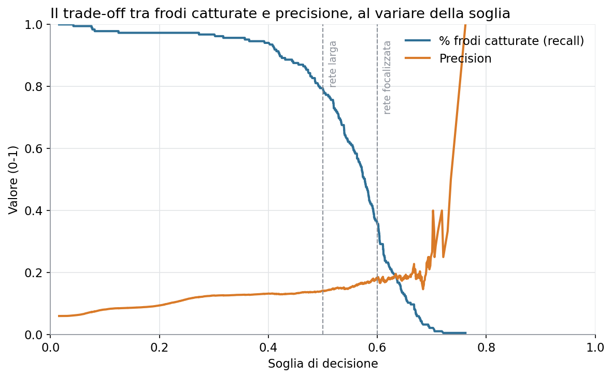
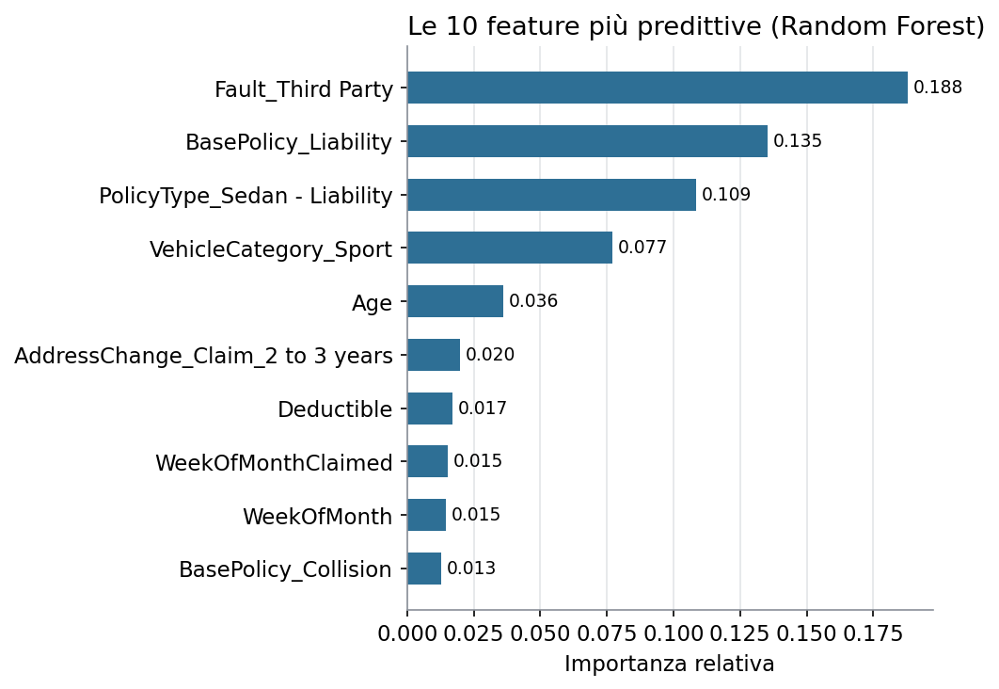
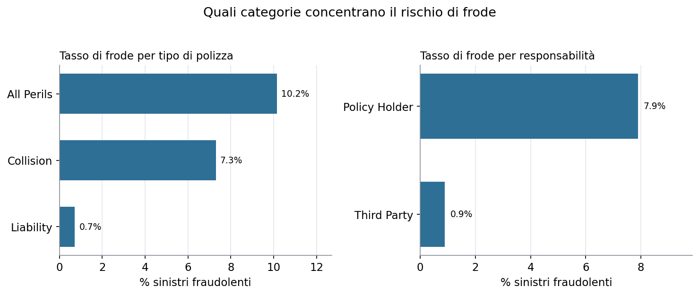

# Motor Insurance Claims Fraud Triage

Un progetto di analisi dati e data architecture sul fraud detection nelle polizze auto, scritto nella forma di una pubblicazione scientifica: letteratura, metodo, risultati, implicazioni di prodotto.

Autrice: Chiara Antonucci
Stato: pipeline dati, modeling e layer di prodotto completi, repository pubblicato

---

## Abstract

Il fraud detection nei sinistri auto è un problema di classificazione fortemente sbilanciato: nel dataset storico di riferimento (15.420 sinistri, Angoss Knowledge Seeker / UNLV), solo il 6% dei casi è fraudolento. Questo progetto confronta due approcci, Logistic Regression e Random Forest, entrambi con bilanciamento delle classi, e analizza il trade-off tra soglia di decisione, carico di lavoro investigativo e frodi intercettate. Il Random Forest si è dimostrato il modello più robusto (PR-AUC 0.170 vs 0.161), oltre a non presentare l'instabilità numerica osservata nella Logistic Regression alle soglie di decisione più alte. Il risultato è tradotto in una proposta di prodotto concreta: una coda di triage con soglia configurabile, che a una soglia di 0.50 intercetterebbe il 78.9% delle frodi segnalando il 33.5% dei sinistri totali.

---

## 1. Introduzione e domanda di business

La frode nei sinistri auto è stimata tra il 20% e il 30% dei claim totali nel settore assicurativo a livello globale, con un impatto diretto su costi operativi e premi. Questo progetto affronta la domanda: **è possibile costruire un modello che assegni un punteggio di rischio frode a ogni sinistro appena denunciato, abbastanza affidabile da alimentare una coda di revisione per gli investigatori, senza sommergerli di falsi positivi?**

La domanda ha due facce:
- **Data Scientist**: qual è il modello più robusto per classificare sinistri fraudolenti in presenza di forte sbilanciamento di classe?
- **Product Manager**: come si traduce quel modello in uno strumento che un team antifrode userebbe davvero, con quale soglia di decisione e quale impatto stimato?

---

## 2. Letteratura correlata

- Yankol-Schalck, *Auto insurance fraud detection: Machine learning and deep learning applications*, Journal of Risk and Insurance, 2025. Confronta modelli ML e DL su un dataset pubblico di sinistri auto, lo stesso lignaggio di dati usato in questo progetto (derivato da "carclaims.csv", Angoss Knowledge Seeker).
- Viaene, Dedene & Derrig (2005), reti bayesiane per il fraud detection assicurativo. Uno dei primi lavori di riferimento del campo.
- Studio su spectral embedding (arXiv) che ripercorre la storia degli approcci al fraud detection assicurativo: alberi decisionali, ensemble neurali, modelli non supervisionati.
- Lavoro che integra CNN e modelli classici (PMC, 2024) su un dataset Kaggle analogo di sinistri auto, confrontato anche con il dataset di frodi su carte di credito europee.

Un elemento ricorrente in questi lavori, confermato anche dai risultati di questo progetto (Sezione 5), è che su dataset con un tasso di frode intorno al 5-6% nessun modello raggiunge una precision alta senza sacrificare drasticamente il recall. I risultati ottenuti qui (precision 0.13-0.18, PR-AUC 0.16-0.17) sono coerenti con questo limite strutturale del problema, più che con una debolezza specifica dell'approccio scelto.

---

## 3. Dati e architettura

**Dataset**: Vehicle Claim Fraud Detection (Kaggle, derivato dal dataset storico "carclaims.csv", Angoss Knowledge Seeker). 15.420 sinistri auto, 32 colonne originali, tasso di frode 6.0% (923 casi). Istruzioni di download in `docs/data_dictionary.md`.

**Architettura a livelli (medallion)**, vedi `docs/architecture.md` per il diagramma completo:

- **Bronze** (`data/bronze/claims_bronze.parquet`): dato grezzo con controlli minimi di validazione (duplicati rimossi, tipi di colonna verificati). La mappatura tra i nomi di colonna del file scaricato e i nomi standardizzati usati dalla pipeline è gestita in `src/config_columns.yaml`, così lo stesso codice è riusabile anche con una versione diversa del dataset.
- **Silver** (`data/silver/claims_silver.parquet`): dato pulito, con gestione esplicita dei valori mancanti (nessuno rilevato in questo dataset) e rimozione delle colonne non informative (identificativi, anno).
- **Gold**: due output distinti. Una tabella di modeling con le feature codificate (`data/gold/claims_train.parquet`, `data/gold/claims_test.parquet`, split 80/20 stratificato), e una tabella di aggregati KPI per tasso di frode per categoria (`data/gold/kpi_fraud_rate.csv`), pensata per alimentare direttamente il layer di prodotto senza ricalcoli dal dato grezzo.

---

## 4. Metodologia

**Gestione dello sbilanciamento**: `class_weight="balanced"` in entrambi i modelli, che pesa gli errori sulla classe minoritaria (frode) in proporzione inversa alla sua frequenza, senza duplicare artificialmente righe (alternativa SMOTE non utilizzata in questa prima versione, valutabile come sviluppo futuro).

**Split train/test**: 80/20 stratificato sul target, per mantenere la stessa proporzione di frodi (6.0%) in entrambi gli insiemi. Con un tasso di base così basso, uno split casuale non stratificato rischia di lasciare troppo pochi casi di frode nel test set per una valutazione affidabile.

**Encoding**: le variabili categoriche sono trasformate in variabili dummy (one-hot encoding, con `drop_first=True` per evitare ridondanza), portando il totale a 121 feature.

**Modelli confrontati**:
- *Logistic Regression* (C=0.1, standardizzazione delle variabili numeriche): modello interpretabile, usato come baseline.
- *Random Forest* (200 alberi, profondità massima 10): modello più flessibile, scelto come candidato finale.

**Metriche di valutazione**: precision, recall, F1 e PR-AUC (area sotto la curva precision-recall), non l'accuratezza semplice. Su una classe minoritaria al 6%, un modello che predice sempre "non frode" avrebbe un'accuratezza del 94% pur essendo inutile.

**Nota metodologica**: durante l'addestramento della Logistic Regression si sono osservati warning di overflow numerico, ricondotti a un fenomeno di quasi-separazione statistica (alcune combinazioni di variabili dummy rare permettono una separazione quasi perfetta di pochi casi, spingendo i pesi del modello verso valori estremi). Il fenomeno è stato mitigato con una regolarizzazione più forte (C=0.1) ma non eliminato del tutto. È stato verificato che non invalida le metriche aggregate, ma rende le stime di probabilità del modello inaffidabili a soglie molto alte (sopra 0.85), un'osservazione che ha pesato sulla scelta del modello finale (si veda Sezione 5).

---

## 5. Risultati

| Modello | Precision | Recall | F1 | PR-AUC |
|---|---|---|---|---|
| Logistic Regression (baseline) | 0.132 | 0.908 | 0.230 | 0.161 |
| Random Forest | 0.141 | 0.789 | 0.240 | 0.170 |

Alla soglia di decisione di default (0.5), entrambi i modelli catturano la maggioranza delle frodi ma segnalano un volume di sinistri troppo alto per essere operativamente utile (33-41% del totale). L'analisi delle soglie (Random Forest) mostra il trade-off tra volume segnalato e frodi catturate:

| Soglia | % sinistri segnalati | % frodi catturate | Precision |
|---|---|---|---|
| 0.50 | 33.5% | 78.9% | 0.141 |
| 0.60 | 11.7% | 35.7% | 0.183 |

Il grafico mostra due delle tre misure della tabella sopra: recall (linea blu, quota di frodi vere catturate) e precision (linea arancione, quota di segnalazioni corrette), entrambe in funzione della soglia. La percentuale di sinistri segnalati sul totale, terza colonna della tabella, non è disegnata nel grafico: quella si legge solo dalla tabella.

**Feature più predittive** (Random Forest):

Il risultato è coerente con l'analisi esplorativa condotta sui dati puliti (silver layer):

Le polizze "Liability" e i sinistri a colpa di terzi hanno un tasso di frode storicamente molto più basso. Una spiegazione plausibile: quando l'assicurato è in colpa, il risarcimento riguarda spesso il proprio veicolo, con un incentivo diretto a gonfiare il danno; quando è un terzo in colpa, il risarcimento passa più spesso attraverso un riscontro esterno (perizia, altro assicuratore), riducendo sia l'opportunità sia l'incentivo a frodare. Questo spiega anche perché `Fault` e `BasePolicy` compaiono entrambe tra le feature più importanti: probabilmente catturano in parte lo stesso segnale, osservato da due angolazioni diverse.

**Perché il Random Forest è stato scelto come modello finale**: oltre al PR-AUC leggermente migliore, le sue stime di probabilità restano affidabili anche a soglie alte, mentre la Logistic Regression mostrava un comportamento instabile sopra 0.85, legato al problema di quasi-separazione statistica descritto in Sezione 4.

---

## 6. Discussione e implicazioni di prodotto

I risultati tecnici si traducono in una decisione di prodotto concreta, descritta nel dettaglio in `product/PRD_fraud_triage.md`: una coda di triage con soglia configurabile, non un sistema di blocco automatico.

Il confronto tra le due soglie proposte si può raccontare così, con ogni numero tracciato alla sua fonte:

- A soglia 0.50 ("rete larga"), catturiamo quasi 8 frodi su 10 (recall 78.9%, leggibile dal grafico sopra, dove la linea blu incontra la riga tratteggiata a 0.50), ma il team deve rivedere un sinistro su tre (33.5% dei sinistri segnalati, dato che compare solo nella tabella, non nel grafico).
- A soglia 0.60 ("rete focalizzata"), il carico scende a circa uno su dieci (11.7% dei sinistri segnalati, dalla tabella), ma catturiamo solo un terzo delle frodi vere (recall 35.7%, leggibile dal grafico), lasciandone scappare i restanti due terzi (64.3%, lo stesso numero visto dal lato opposto).

Una precision nell'ordine di 0.14-0.18 può apparire bassa in assoluto, ma è coerente con quanto riportato nella letteratura di settore su problemi con lo stesso livello di sbilanciamento (circa 6% di frodi). Il valore del modello non sta nel sostituire il giudizio dell'investigatore, ma nel ridurre drasticamente il numero di sinistri da esaminare senza guida, mantenendo alta la probabilità di intercettare le frodi vere.

---

## 7. Limiti e sviluppi futuri

- Il dataset non contiene un importo del sinistro in valuta, solo una fascia di prezzo del veicolo: non è possibile stimare direttamente l'impatto economico delle frodi intercettate, solo il volume.
- Il dataset copre un periodo limitato e un solo mercato (USA, anni '90): un modello in produzione richiederebbe un retraining su dati locali e più recenti.
- La Logistic Regression ha mostrato instabilità numerica a soglie alte (Sezione 4). Non è stata approfondita una soluzione più strutturale (es. raggruppamento delle categorie più rare prima dell'encoding), lasciata come sviluppo futuro.
- SMOTE o altre tecniche di oversampling non sono state testate in questa versione; potrebbero migliorare il recall a parità di precision rispetto al solo class weighting.
- Nessuna validazione incrociata (cross-validation): i risultati si basano su un singolo split train/test.
- `Fault` e `BasePolicy` mostrano un segnale sovrapposto (Sezione 5): un'analisi di correlazione tra le feature prima del modeling avrebbe potuto semplificare il set di variabili senza perdita di informazione.

---

## Struttura del repository

insurance-fraud-triage/
├── README.md
├── PROJECT_PLAN.md
├── requirements.txt
├── data/
│   ├── raw/
│   ├── bronze/
│   ├── silver/
│   └── gold/
├── src/
│   ├── ingest.py
│   ├── silver.py
│   ├── gold.py
│   ├── modeling.py
│   ├── threshold_analysis.py
│   ├── visualize.py
│   └── config_columns.yaml
├── notebooks/
├── docs/
│   ├── architecture.md
│   ├── data_dictionary.md
│   └── figures/
└── product/
    └── PRD_fraud_triage.md