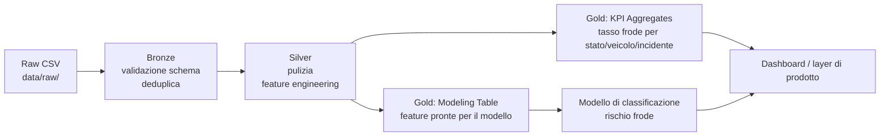

# Architettura dati

Architettura a livelli (medallion), scelta comune nei progetti di data warehousing moderni perché separa in modo netto "dato grezzo", "dato pulito" e "dato pronto per l'uso", rendendo ogni passaggio tracciabile e ripetibile.

## I tre livelli

**Bronze**: il CSV scaricato viene letto così com'è, solo con controlli minimi (colonne attese presenti, tipi di dato coerenti, righe duplicate rimosse). Nessuna trasformazione di significato: deve restare tracciabile fino alla fonte originale.

**Silver**: qui avviene la pulizia vera: valori mancanti gestiti esplicitamente (non rimossi in silenzio), categorie normalizzate, feature derivate create (per esempio età della polizza al momento del sinistro, numero di sinistri precedenti per assicurato).

**Gold**: due output distinti dallo stesso livello silver:
- una tabella di modeling, con le feature pronte per l'addestramento del classificatore
- una tabella di aggregati KPI (tasso di frode per stato, tipo veicolo, tipo incidente), che alimenta il layer di prodotto senza bisogno di ricalcolare nulla dal dato grezzo

## Modello a stella (gold layer)

Per la tabella di modeling e gli aggregati, lo schema di riferimento è a stella:

- **Fact table**: un sinistro per riga (importo, esito frode, data)
- **Dimensioni**: assicurato, polizza, veicolo, tipo di incidente, tempo

Questo rende semplice rispondere a domande come "qual è il tasso di frode per tipo di veicolo nell'ultimo trimestre" con un singolo join, invece di ricostruire la logica ogni volta.
